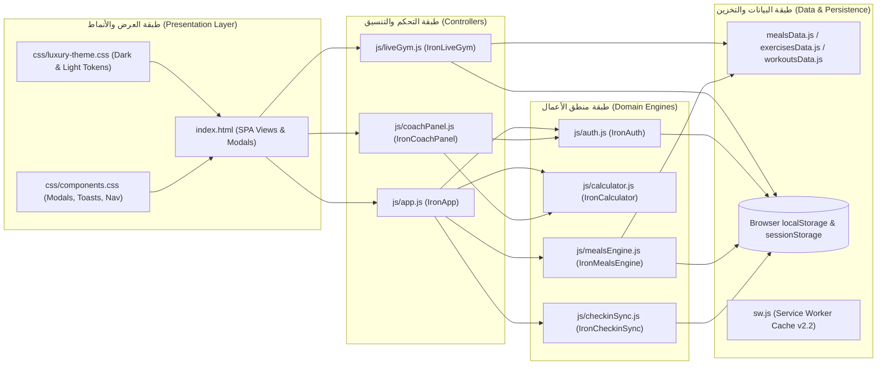

# 📐 وثيقة المعمارية التقنية للنظام (System Architecture Document)
**المنصة:** أيرون كوتش (IronCoach Pro v2.2)

---

## 1. نظرة عامة معمارية (Architectural Overview)

تم تصميم منصة **أيرون كوتش (IronCoach Pro)** وفق نمط **تطبيق الصفحة الواحدة التقدمي (Offline-First Single-Page PWA)** بدون اعتماديات بناء معقدة (Zero-Build Vanilla JS Architecture)، مما يمنحها:
1. **سرعة تحميل فورية (Instant First Contentful Paint)**.
2. **استقلالية تامة في التشغيل والاستضافة** على أي خادم ملفات ثابتة (GitHub Pages, Netlify, Cloudflare Pages, أو خادم محلي).
3. **فصل صارم للاهتمامات (Separation of Concerns)** عبر تقسيم المنطق البرمجي إلى 11 وحدة مستقلة (`js/*.js`).

---

## 2. هيكلية التخزين المحلي (localStorage Data Schemas)

تعتمد المنصة على مفاتيح مهيكلة ومنظمة داخل `localStorage` و `sessionStorage`:

| المفتاح (`Key`) | النوع | الوصف والهيكلية |
| :--- | :---: | :--- |
| `iron_theme` | `String` | يحفظ النمط اللوني المفضل للمستخدم (`"dark"` أو `"light"`). يتم تطبيقه في `<head>` قبل الرسم لمنع وميض الشاشة (FOUC). |
| `iron_coach_config` | `JSON Object` | إعدادات المنصة وبيانات الكوتش، تشمل: `coachInfo` (الاسم، اللقب، واتساب، فودافون كاش، انستاباي، STC Pay، IBAN، رابط الدفع، و `passwordHash`) و `subscriptionPrice`. |
| `iron_trainees` | `JSON Array` | مصفوفة المشتركين، يحتوي كل عنصر على: `id`, `name`, `username`, `password` (مشفرة بـ `hashPassword`), `phone`, `joinedDate`, `subscriptionDays`, `daysLeft`, `status`, `goal`, `calories`, `macros`, `program`, `weight`, `height`, `age`, `gender`, `activity`, `history[]`. |
| `iron_session` | `JSON Object` | الجلسة النشطة حالياً (`role: "coach" | "trainee"`, `id`, `username`, `isImpersonating`). |
| `iron_custom_meals` | `JSON Array` | الوجبات المخصصة التي يضيفها المستخدم فوق قاعدة الـ 100 وجبة الأساسية. |
| `iron_saved_diets` | `JSON Map` | خريطة تربط كل `traineeId` بجدول وجباته اليومي المحفوظ (`breakfast`, `lunch`, `dinner`, `snack`, `totalCalories`, `difference`). |
| `iron_workout_logs` | `JSON Array` | سجل الجلسات التدريبية المكتملة، يشمل: `id`, `traineeId`, `date`, `programName`, `dayTitle`, `completedSets`, `totalSets`, `totalVolumeKg`. |
| `iron_water_logs` | `JSON Map` | سجل عدد أكواب الماء المستهلكة يومياً بنسق `${traineeId}_${YYYY-MM-DD}: cupsCount`. |
| `iron_active_workout` | `sessionStorage` | مسودة جلسة التمرين الجارية حالياً في الجيم لحفظ الأوزان والعدّات في حال إغلاق النافذة بالخطأ. |

---

## 3. معمارية محرك الأنماط المزدوج (Dual-Theme Engine Architecture)

لتوفير تجربة بصرية مثالية في كل من **الوضع الداكن الفاخر (Luxury Dark)** و**الوضع الفاتح الرياضي (Athletic Daylight)** دون تكرار الكود:
1. **المتغيرات الدلالية (Semantic CSS Variables)**:
   - تم تعريف متغيرات الأسطح (`--bg-main`, `--bg-card`, `--bg-elevated`, `--bg-input`, `--bg-subtle`) والنصوص (`--text-main`, `--text-secondary`, `--text-muted`) والحدود (`--border-color`) تحت `:root` للوضع الداكن، وتحت `html[data-theme="light"]` للوضع الفاتح.
2. **التحويل الدلالي التلقائي (Semantic Utility Mapping)**:
   - تقوم قواعد `html[data-theme="light"]` في `css/luxury-theme.css` بتكييف فئات الأسطح الداكنة (`bg-slate-900`, `bg-slate-950`, `border-slate-800`, `text-white`) إلى مقابلها الفاتح عالي التباين، مع تعديل درجات الألوان المميزة (`emerald-400` → `emerald-600`, `amber-400` → `amber-600`) لتحقيق معيار التباين القياسي **WCAG AA/AAA**.
3. **الرسوم المتجهية التكيفية (Theme-Aware Fallback SVGs)**:
   - دوال `getExerciseFallbackSvg` و `getMealFallbackSvg` في `js/app.js` تقرأ النمط النشط وتولد رسوماً بديلة متناسقة مع الخلفية الفاتحة أو الداكنة.

---

## 4. نموذج الأمان والخصوصية (Security Model)

- **تشفير كلمات المرور محلياً (`hashPassword`)**: لا يتم تخزين أي كلمة مرور كنص صريح (Plaintext) في `localStorage`؛ تمر جميع كلمات المرور عبر دالة التجزئة الثنائية ذات البادئة `h$` مع ترحيل تلقائي لأي بيانات قديمة عند القراءة.
- **عزل البيانات والنسخ الاحتياطي**: يوفر النظام آلية تصدير واستيراد كاملة بصيغة JSON (`IronAuth.exportBackupData` / `IronAuth.importBackupData`) تتيح للكوتش الاحتفاظ بنسخ خارجية آمنة من بيانات متدربيه.

---

## 5. خارطة طريق الترقية إلى خادم سحابي (Cloud Backend Migration Blueprint)

عند الرغبة في تحويل المنصة من `localStorage` إلى نظام سحابي متعدد الأجهزة (Multi-Device SaaS) باستخدام **Supabase (PostgreSQL + Auth + Storage)**:
1. **طبقة المصادقة (`js/auth.js`)**: استبدال دوال `getAllTrainees` و `login` باستدعاءات `supabase.auth.signInWithPassword()` وجدول `profiles` محمي بسياسات أمان الصفوف (`Row Level Security - RLS`).
2. **رفع إيصالات الدفع**: ربط حقل `receiptUploadInput` بـ **Supabase Storage Bucket** (`receipts/`) وإرسال إشعار لحظي للكوتش لاعتماد التجديد.
3. **مزامنة سجلات الجيم والوزن**: ربط `iron_workout_logs` و `history` بجدولي `workout_logs` و `checkins` في PostgreSQL مع الإبقاء على `localStorage` كطبقة كاش أوفلاين (Optimistic UI Cache).
