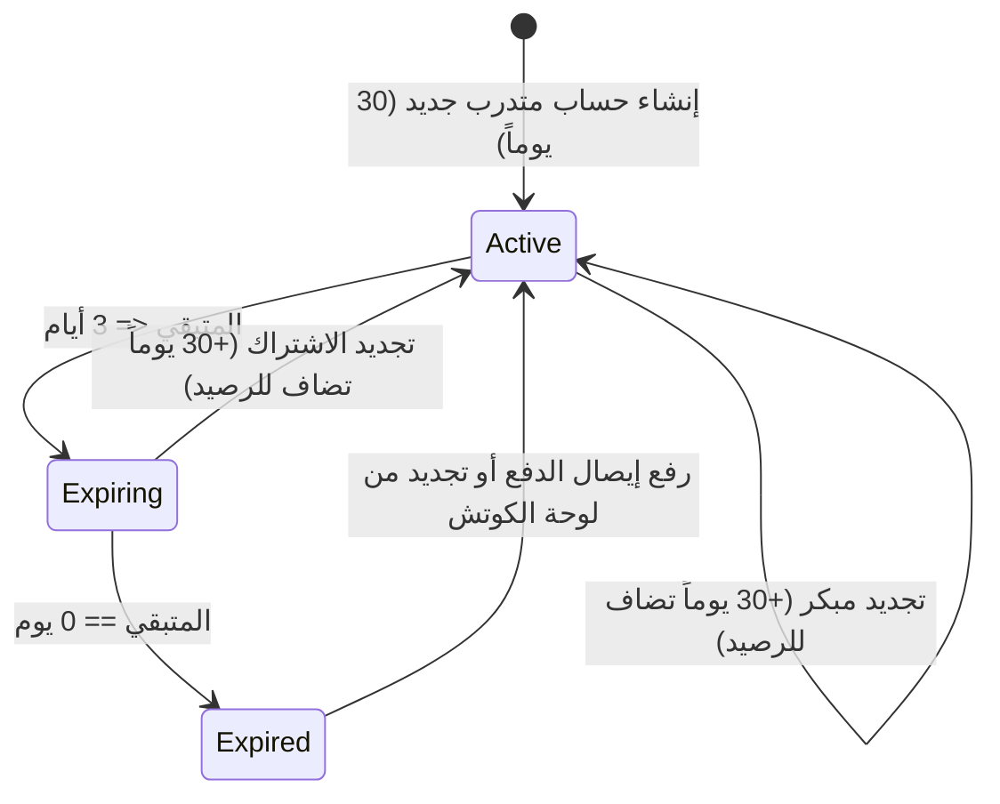

# 📋 وثيقة متطلبات المنتج وخارطة الطريق (PRD & Product Roadmap)
**المنصة:** أيرون كوتش (IronCoach Pro v2.2)

---

## 1. رؤية المنتج والهدف (Product Vision)

تمكين مدربي اللياقة البدنية والتغذية الرياضية في العالم العربي من إدارة متدربيهم واشتراكاتهم الشهرية عبر منصة رقمية موحدة تجمع بين **الدقة العلمية في حساب السعرات والماكروز**، **المرونة في استبدال الوجبات والتمارين**، و**سهولة المتابعة الأسبوعية وتجديد الاشتراك عبر الواتساب والمحافظ المحلية**.

---

## 2. فئات المستخدمين (User Personas)

1. **الكوتش / المدير (Coach / Admin)**:
   - يحتاج إلى لوحة تحكم سريعة لمتابعة حالة اشتراكات المتدربين (من سينتهي اشتراكه قريباً ومن انتهى اشتراكه).
   - يحتاج إلى إنشاء وتعديل خطط المتدربين (هدف السعرات، البرنامج التدريبي، مدة الاشتراك) في ثوانٍ.
   - يحتاج إلى استقبال تقارير المتابعة الأسبوعية وإيصالات التجديد مباشرة عبر واتساب.
2. **المتدرب النشط (Active Trainee)**:
   - يحتاج إلى معرفة سعراته وماكروزه اليومية وكمية الماء المطلوبة بوضوح.
   - يحتاج إلى جدول وجبات يومي واضح بالجرامات مع إمكانية استبدال أي وجبة لا تتوفر مكوناتها بوجبة مكافئة.
   - يحتاج إلى فتح برنامجه التدريبي داخل الجيم، معرفة الأداء الصحيح بالصور المتحركة، تشغيل مؤقت الراحة، وإيجاد تمرين بديل فوري إذا كان الجهاز مشغولاً.
3. **المتدرب المنتهي اشتراكه (Expired Trainee)**:
   - يحتاج إلى شاشة واضحة تعرض وسائل الدفع المتاحة (فودافون كاش، انستاباي، STC Pay، بطاقة بنكية) ورفع صورة الإيصال لتجديد اشتراكه فوراً.

---

## 3. المعادلات العلمية المعتمدة (Scientific Formulas Specification)

### أ. حساب معدل الأيض الأساسي (Mifflin-St Jeor BMR)
- **للذكور:**
  $$\text{BMR} = (10 \times \text{Weight}_{\text{kg}}) + (6.25 \times \text{Height}_{\text{cm}}) - (5 \times \text{Age}) + 5$$
- **للإناث:**
  $$\text{BMR} = (10 \times \text{Weight}_{\text{kg}}) + (6.25 \times \text{Height}_{\text{cm}}) - (5 \times \text{Age}) - 161$$

### ب. إجمالي استهلاك الطاقة اليومي (TDEE) والسعرات المستهدفة
$$\text{TDEE} = \text{BMR} \times \text{Activity Factor} \quad (\text{1.2 إلى 1.725})$$
$$\text{Target Calories} = \max(1200, \text{round}(\text{TDEE} + \text{Goal Offset}))$$

### ج. توزيع المغذيات الكبرى (Macro Split - NASM Standard)
- **البروتين:** $2.0\text{ g} \times \text{Weight}_{\text{kg}}$ ($4\text{ kcal/g}$).
- **الدهون الصحية:** $25\%$ من إجمالي السعرات المستهدفة ($9\text{ kcal/g}$).
- **الكربوهيدرات:** باقي السعرات المستهدفة مقسوماً على $4\text{ kcal/g}$.
- **احتياج الماء اليومي:** $\text{Weight}_{\text{kg}} \times 0.035\text{ Liters}$.

---

## 4. آلة حالة الاشتراك (Subscription Lifecycle State Machine)

---

## 5. خارطة الطريق المستقبلية (Product Roadmap)

### المرحلة 1: الأساس التفاعلي المحلي (مكتملة ✅ - v2.1)
- نظام الصلاحيات (كوتش / متدرب) وعداد الـ 30 يوماً.
- قاعدة بيانات الـ 100 وجبة ومولد الدايت الذكي.
- الـ 6 برامج تدريبية ومكتبة التمارين المصورة ووضع الجيم المباشر.
- تقارير المتابعة الأسبوعية عبر الواتساب.

### المرحلة 2: تجربة الاستخدام المتقدمة والنمط المزدوج (مكتملة ✅ - v2.2)
- محرك النمطين الداكن والفاتح (`Dark / Light Theme Toggle`) مع حفظ التفضيل.
- إدارة كاملة للمتدربين في لوحة الكوتش (بحث، تعديل، حذف، مراسلة واتساب، نسخ احتياطي واستعادة JSON).
- حفظ خطة الدايت اليومية لكل متدرب ومشاركتها عبر واتساب.
- متتبع شرب الماء التفاعلي، واجهة سجل التمارين المكتملة، ومنحنى تطور الوزن (`SVG Chart`).

### المرحلة 3: السحابة والذكاء الاصطناعي (القادمة 🚀 - v3.0)
- ربط سحابي كامل عبر **Supabase / Firebase** للمزامنة الفورية بين جهاز الكوتش وأجهزة المتدربين.
- إشعارات ويب تذكيرية (`Web Push Notifications`) لمواعيد شرب الماء والتمرين وتجديد الاشتراك.
- تصدير خطة المتدرب (الدايت + البرنامج التدريبي) كملف **PDF** رسمي يحمل شعار الكوتش.
- مقارنة صور تطور المتدرب (Before / After Progress Photos) بخصوصية تامة.
